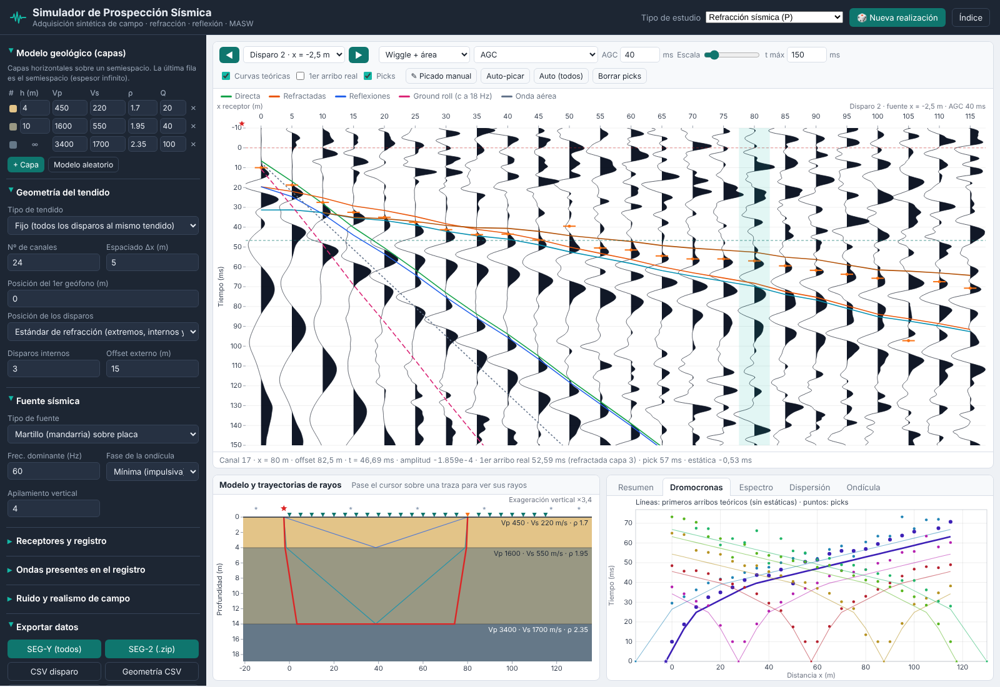
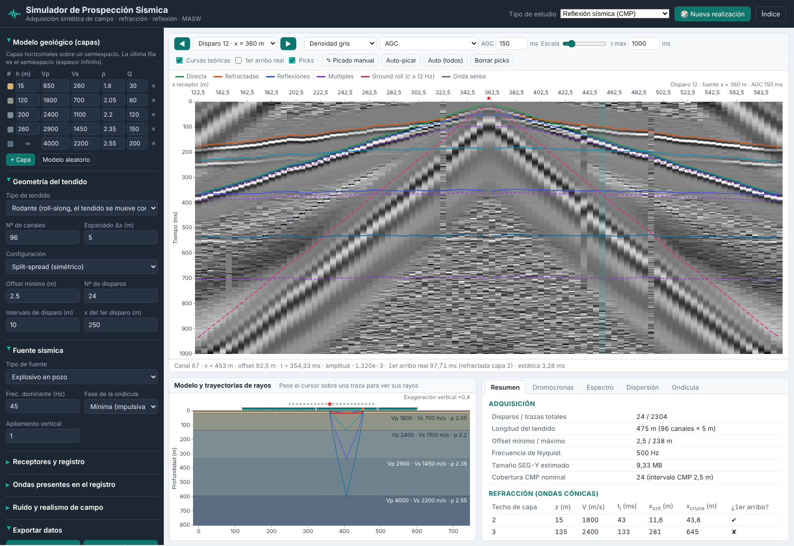

# 01 · Prospección Sísmica

Simulador interactivo de **adquisición sísmica de campo** para el aprendizaje.
Genera registros sintéticos (sismogramas de disparo) a partir de un modelo de capas, con la
geometría, la fuente, los receptores y el ruido que se elijan, y exporta los datos en los
formatos que usan los sismógrafos reales, para procesarlos después con otro software.



**Abrir:** doble clic en [`simulador_sismico.html`](simulador_sismico.html). No necesita
instalación, servidor ni internet: es HTML + JavaScript puro, así que funciona también en campo.

## Tipos de estudio incluidos

| Estudio | Preset | Qué se aprende |
|---|---|---|
| **Refracción sísmica (P)** | 24 canales × 5 m, martillo, 7 disparos (externos, extremos, internos) | Dromocronas, distancias crítica y de cruce, tiempos de intercepto, capas ocultas e inversiones de velocidad, picado de primeros arribos |
| **Reflexión sísmica (CMP)** | 96 canales × 5 m, split-spread rodante, explosivo, 24 disparos | Hipérbolas de reflexión, múltiples, ground roll, onda aérea, cobertura CMP, resolución λ/4 |
| **MASW** | 24 canales × 1 m, geófonos de 4.5 Hz, disparos a 10 m | Dispersión de ondas Rayleigh, imagen f–c (desplazamiento de fase), λ máx/mín, aliasing espacial |

Todos los parámetros se pueden cambiar; los presets sólo son puntos de partida.



## Qué simula

**Modelo:** capas horizontales homogéneas (h, Vp, Vs, ρ, Q) sobre un semiespacio.

**Ondas** (se pueden activar o desactivar por separado):

- **Onda directa:** `t = x / V1`
- **Refractadas críticamente (ondas cónicas)** en cada interfaz:
  `t = x/Vn + Σ 2 hj √(1/Vj² − 1/Vn²)`, sólo si `x ≥ x_crít` y `Vn > Vj` para todas las capas superiores
  (si una capa es más lenta que otra de arriba no genera onda cónica: capa de baja velocidad).
- **Reflexiones primarias:** trazado de rayos exacto (se resuelve `X(p) = x` por bisección) con
  coeficiente de reflexión acústico que depende del ángulo (reflexión total poscrítica) y
  pérdidas por transmisión.
- **Múltiples de superficie** de primer orden (R = −1 en la superficie libre).
- **Ground roll:** ondas Rayleigh dispersivas, modo fundamental (ver *Limitaciones*).
- **Onda aérea:** 343 m/s.

**Física de la señal:**

- Ondícula de Ricker (martillo, caída de peso, escopeta, explosivo) o de Klauder (vibroseis
  correlacionado), en **fase mínima** o **fase cero**.
- Atenuación anelástica **Q constante causal** (Kolsky–Futterman): `e^{−πf t*}` más su dispersión de velocidad.
- Divergencia geométrica.
- Respuesta del **geófono** (oscilador amortiguado con f0 y ζ) y filtro **antialias**.
- La síntesis se hace en el dominio de la frecuencia, así que los tiempos de llegada pueden
  caer entre muestras (no hay errores de redondeo al muestreo).

**Realismo de campo** (todo reproducible con la *semilla*):

| Efecto | Descripción |
|---|---|
| Ruido ambiental | Gaussiano de banda 2–150 Hz; baja √N con el apilamiento vertical |
| Inducción de red | 50/60 Hz con su 3.er armónico, amplitud distinta en cada estación |
| Ruido cultural | Ráfagas locales (pasos, vehículos, viento) que se propagan con su propio moveout |
| Estáticas | Retardos suaves y aleatorios a lo largo de la línea (capa meteorizada irregular) |
| Jitter del disparador | Error de tiempo cero en cada golpe; al apilar se promedia y suaviza la ondícula |
| Trazas defectuosas | Geófonos muertos, polaridad invertida, mal acople (ganancia lognormal) y picos eléctricos. Dependen de la estación, así que un geófono muerto sigue muerto en todos los disparos |

## Herramientas de la interfaz

- **Visualización:** wiggle, wiggle con área rellena y densidad (gris o rojo-azul). Ganancias
  AGC, normalización por traza, t² o amplitud real. Las ganancias sólo afectan a lo que se ve,
  **nunca a los datos exportados**.
- **Curvas teóricas** de todas las ondas y el **primer arribo verdadero** superpuestos.
- **Picado manual** (clic o arrastre; Shift para borrar) y **automático**: detección por razón
  de energía y refinamiento con MER. Los picks se exportan junto al tiempo verdadero para
  medir el error.
- **Modelo con trayectorias de rayos** de la traza bajo el cursor.
- **Análisis:** dromocronas de todos los disparos, espectro de amplitud, imagen de dispersión
  f–c, ondícula de la fuente y un **resumen de control de calidad** con avisos: aliasing
  temporal y espacial, registro demasiado corto, capas ocultas, inversiones de velocidad,
  geófono inadecuado para la frecuencia de la fuente, tendido corto.

## Formatos de exportación

| Botón | Archivo | Contenido |
|---|---|---|
| SEG-Y (todos) | `.sgy` | SEG-Y rev 1, big-endian, IEEE float32 (código 5), todos los disparos |
| SEG-2 (.zip) | `1001.sg2`, `1002.sg2`… + `geometria.csv` + `proyecto.json` | Un archivo SEG-2 rev 1 por disparo, como los graba un sismógrafo de refracción |
| CSV disparo | `disparo_N.csv` | Columna de tiempo (ms) + una columna por traza |
| Geometría CSV | `geometria.csv` | disparo, FFID, x fuente, canal, x receptor, offset, x punto medio |
| Picks CSV | `picks_*.csv` | Tiempo picado y tiempo verdadero (con estáticas y jitter) y tipo de onda |
| Imagen PNG | `disparo_N.png` | La vista actual del registro |
| Guardar / Cargar proyecto | `.json` | Todos los parámetros y el modelo, para reproducir exactamente la simulación |

### Cabeceras SEG-Y de traza usadas (bytes, base 1)

| Bytes | Campo | Valor |
|---|---|---|
| 1–4 / 5–8 | Secuencia en línea / en archivo | 1, 2, 3… |
| 9–12 | FFID | 1000 + nº de disparo |
| 13–16 | Canal | 1…N |
| 17–20 | Punto de fuente | nº de disparo |
| 21–24 | CDP | round(2·x_medio / Δx) |
| 29–30 | Código de traza | 1 = sísmica, 2 = muerta |
| 31–32 | Apilamiento vertical | nº de golpes |
| 37–40 | Offset | x_receptor − x_fuente (m, entero) |
| 71–72 | SCALCO | −100 (coordenadas en cm) |
| 73–76 / 81–84 | X fuente / X receptor | × 100 |
| 109–110 | Retardo de registro | −pre-disparo (ms) |
| 115–116 / 117–118 | Muestras / dt (µs) | |
| 141–142 / 149–150 | Antialias / corte bajo (f0 del geófono) | Hz |
| 181–184 | CDP X | × 100 |

La cabecera textual (EBCDIC) incluye el **modelo de capas verdadero**, para comparar con los
resultados del procesamiento.

Los archivos se validaron con [ObsPy](https://docs.obspy.org/) y con
[`herramientas/leer_datos.py`](herramientas/leer_datos.py): SEG-Y, SEG-2 y CSV contienen
exactamente los mismos datos.

```bash
pip install numpy matplotlib
```

```bash
python herramientas/leer_datos.py sismica_refraccion.sgy --graficar
```

## Limitaciones conocidas (para tenerlas en cuenta al aprender)

- **Capas horizontales:** todavía no hay buzamiento, topografía ni variaciones laterales.
  Las estáticas aleatorias imitan las irregularidades someras.
- **Amplitudes aproximadas:** la cinemática (tiempos) es exacta, pero las amplitudes de las
  ondas cónicas y del ground roll son modelos simplificados. La reflexión es acústica (onda P,
  sin conversiones P–S).
- **Dispersión de Rayleigh aproximada:** se usa un promedio de la lentitud de Rayleigh de cada
  capa, ponderado en profundidad (kernel exponencial, L = λ/4). Sirve para ver la tendencia del
  modo fundamental, pero **no** sustituye a un cálculo exacto (Thomson-Haskell, matrices de
  propagación). No hay modos superiores.
- El picador automático tiene un sesgo de unos milisegundos después del onset (típico de los
  métodos de razón de energía) y empeora con el ruido a offsets grandes. Es intencional: así
  se aprende a revisar los picks.

## Hoja de ruta

- [ ] Interfaces buzantes y topografía (refracción con métodos de tiempo-retardo, GRM).
- [ ] Ondas SH (refracción con fuente de corte) y polaridad invertida entre golpes.
- [ ] Dispersión exacta de Rayleigh y modos superiores.
- [ ] Modelo 2D por celdas con primeros arribos por *fast marching* (tomografía).

## Estructura

```
01_Prospeccion_Sismica/
├── simulador_sismico.html   ← abrir en el navegador
├── css/estilos.css
├── js/
│   ├── fisica.js            ← motor físico (modelo, rayos, ondículas, síntesis, picado)
│   ├── exportar.js          ← escritores SEG-Y, SEG-2, ZIP, CSV
│   └── interfaz.js          ← interfaz, gráficos y presets
├── herramientas/
│   └── leer_datos.py        ← lector SEG-Y/SEG-2 en Python (NumPy)
└── docs/                    ← capturas
```
